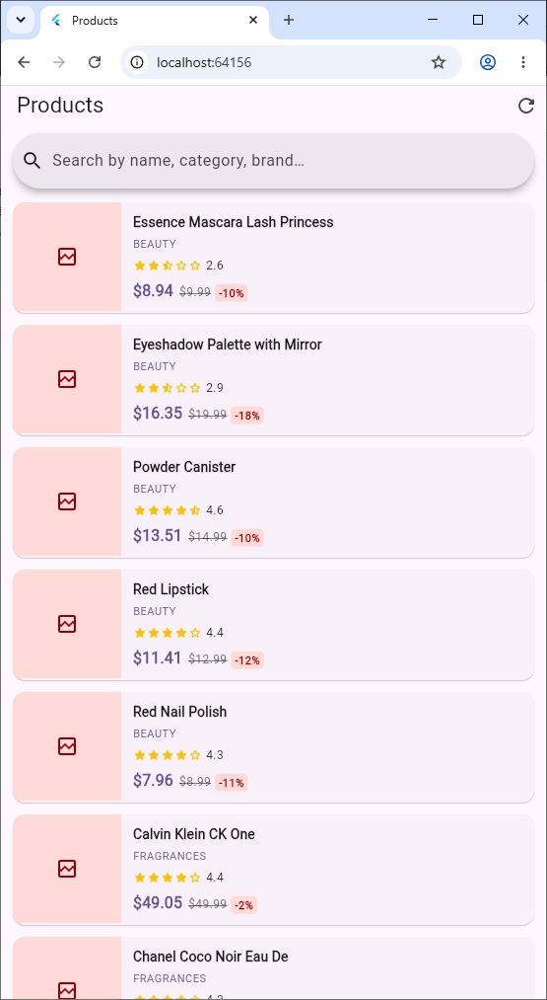

# Flutter REST Products

A modernized Flutter application that browses products from the [dummyjson.com](https://dummyjson.com) REST API. Built with Material 3, clean architecture, real-time search filtering, half-star rating precision, dynamic discount calculation, image carousels, and cart interactions.

---

## 📱 Screenshots

<p align="center">
  <a href="screen1.jpg">
    
  </a>
</p>

<p align="center">
  <em><a href="screen1.jpg">View full-size screenshot (screen1.jpg)</a></em>
</p>

---

## ✨ Features

- **REST API Integration**: Fetches real-time product data from `dummyjson.com/products?limit=100`.
- **Search & Filter**: Instant filtering across product titles, categories, and brands.
- **Material 3 Design**: Fully adapted with `useMaterial3: true`, dynamic color schemes (`ColorScheme.fromSeed`), and light/dark mode support.
- **Image Carousel & Hero Transitions**: Smooth PageView with indicators and Hero animations between list and detail views.
- **Star Rating**: Half-star precision rendering reflecting the actual API rating score.
- **Pricing & Discounts**: Calculates and formats discounted prices with percentage badge and original strikethrough price.
- **Stock Availability**: Live in-stock indicator with color-coded status.
- **Interactive Cart**: In-memory shopping cart counter with badge updates and floating SnackBar notifications.
- **Robust Error & Empty States**: User-friendly retry interface for network errors and clean empty-search feedback.
- **Cached Images**: Fast image loading with placeholder and error fallback management via `cached_network_image`.

---

## 🏗️ Project Architecture

```
lib/
├── main.dart                       # App entry point, theme setup, routing
├── models/
│   └── product.dart                # Product entity, JSON serialization, getters
├── services/
│   └── product_service.dart        # HTTP client handling dummyjson API requests
├── screens/
│   ├── home_screen.dart            # Product catalog list, search bar, state handling
│   └── product_detail_screen.dart   # Image carousel, product specs, cart actions
└── widgets/
    ├── product_card.dart           # Catalog item card with thumbnail & pricing
    └── star_rating.dart            # Reusable fractional star rating component
```

---

## 🚀 Getting Started

### Prerequisites

- Flutter SDK ≥ 3.1.5
- Dart SDK ≥ 3.1.5

### Installation & Run

1. Navigate to the project root:
   ```bash
   cd "Flutter_REST"
   ```

2. Fetch packages:
   ```bash
   flutter pub get
   ```

3. Launch the application:
   ```bash
   flutter run
   ```

### Build Release APK

```bash
flutter build apk --release
```

---

## 📦 Dependencies

| Package | Purpose |
|---------|---------|
| [`http`](https://pub.dev/packages/http) | REST API requests |
| [`cached_network_image`](https://pub.dev/packages/cached_network_image) | Image caching and fallbacks |
| [`cupertino_icons`](https://pub.dev/packages/cupertino_icons) | Iconography support |

---

## 🌐 API Reference

Powered by the free [DummyJSON](https://dummyjson.com/) API:

- **Endpoint**: `GET https://dummyjson.com/products?limit=100`
- **Authentication**: None required

---

## 📄 License

MIT
